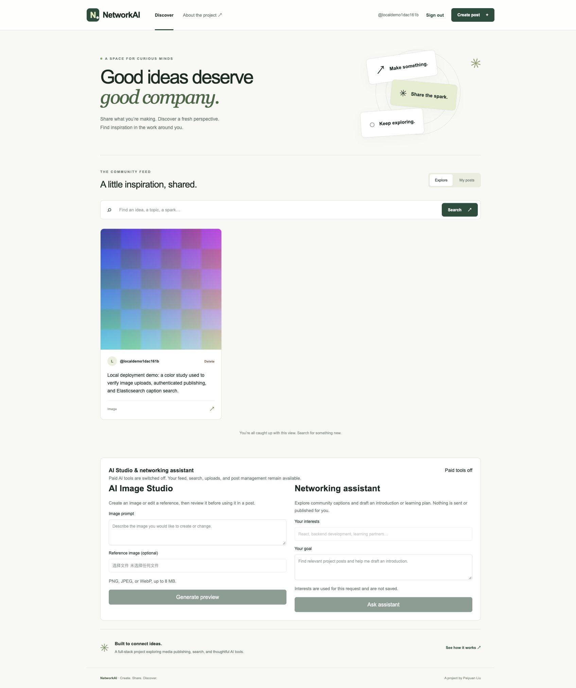
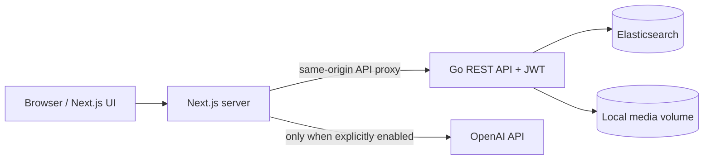

# NetworkAI

A full-stack media-sharing application built with **Next.js, React, TypeScript, Go, and Elasticsearch**. Discover posts, search captions, publish images or videos, and manage your own content through an authenticated workspace.

The project includes an optional AI image studio and a networking assistant. **Paid AI calls are disabled in the delivered local configuration.** The core application runs locally without a cloud account or an OpenAI key.



## Features

- **Accounts:** registration, bcrypt password hashing, JWT sign-in, and session expiry handling.
- **Discovery:** real Elasticsearch caption search and exact author filtering, with loading, empty, and error states.
- **Media publishing:** upload an image or video with a caption; review your own posts and confirm deletion.
- **Local storage:** persistent Elasticsearch indexes and media files, with same-origin media delivery and video range requests.
- **AI Studio:** optional image generation or reference-image editing, preview first, and publish only after an explicit action.
- **Networking assistant:** an optional model-guided, read-only caption-search tool with bounded execution and visible retrieved sources.
- **Reproducible setup:** Docker Compose, generated local secrets, health checks, and start/stop scripts for macOS.

## Architecture



Only the web application is published to `127.0.0.1`. The Go service and Elasticsearch communicate on the internal Compose network. Database and media volumes persist when the application is stopped and restarted.

## Run on your computer

Install Python 3 and Docker Desktop. Start Docker Desktop, then run from the repository root:

```sh
sh scripts/local.sh up
```

Open **http://localhost:3000** and create an account. The script generates a private `.env` with random database and JWT secrets on the first run, builds the application, and waits for healthy services.

On macOS, you can also double-click **Start NetworkAI.command**. To stop the application while preserving your data, double-click **Stop NetworkAI.command** or run:

```sh
sh scripts/local.sh stop
```

Other commands:

```sh
sh scripts/local.sh status
sh scripts/local.sh logs
python3 scripts/smoke-test.py
```

If port 3000 is already in use, change `WEB_PORT` in your private `.env`, then run the startup script again. When using another port, pass its URL to the smoke test with `--url http://localhost:PORT`.

## Paid AI controls

The server requires `ENABLE_PAID_AI=true` and a configured `OPENAI_API_KEY` before making paid AI calls. The delivered deployment uses `ENABLE_PAID_AI=false`; generation, image editing, and assistant requests are blocked by the server while the rest of the application remains available.

If you intentionally enable these features later, use your own API key and available models in the private root `.env`. The example configuration defaults are `gpt-image-2` for images and `gpt-4.1-mini` for the assistant. API access and usage are billed by the provider. Keys stay on the server and are never included in browser code or the repository.

To disable paid AI again and apply the setting:

```sh
python3 scripts/disable-paid-ai.py
docker compose up -d --no-deps --force-recreate web
```

AI image previews do not publish automatically. The assistant's search tool reads existing posts; it cannot create or delete posts. Personal interests apply to the current request rather than being stored as a profile.

## Development and verification

Frontend, from `frontend/`:

```sh
npm ci
npm test
npm run lint
npm run build
```

Backend, with Go 1.27.3 installed, from `backend/`:

```sh
go test -race ./...
go vet ./...
```

Alternatively, run the backend checks in the official Go image:

```sh
docker run --rm -v "$PWD/backend:/app" -w /app golang:1.27.3 sh -c 'go test -race ./... && go vet ./...'
```

The AI regression tests use mocked provider responses. Live image generation and editing were not verified for this delivery; paid features remain switched off.

The live smoke test verifies authentication, media upload and retrieval, Elasticsearch search, author-only deletion, and removal of deleted local media. It creates temporary test posts and removes them afterward.

## Project layout

```text
backend/           Go API, authentication, search, storage adapters, and tests
frontend/          Next.js application, API proxy, AI routes, UI, and tests
scripts/           Local configuration, startup, shutdown, and smoke checks
compose.yaml       Local web, API, search, and persistent storage services
.env.example       Configuration names and safe placeholder values
```

See [backend/API.md](backend/API.md) for the REST contract. An optional Google Cloud Storage adapter remains available in the backend; the standard local deployment uses disk storage.

## Current scope

Elasticsearch search is caption keyword matching, rather than semantic/vector search. The current API returns a bounded result page without a pagination interface. Paid AI requires a valid provider account and is intentionally switched off after setup.

This is a course-inspired portfolio project. The local deployment, storage adapters, completed web interface, and verification workflow make the application reproducible without the original classroom cloud resources.
